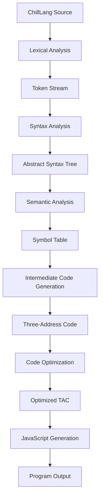

<div align="center">

# `ChillLang`

### A language of your own. A compiler you can inspect.

**A multi-phase mini programming language and compiler workbench**

Write ChillLang. Follow the compilation process. Inspect the intermediate code. Understand the transformation into JavaScript.

<br/>


</div>

---

## Overview

**ChillLang** is an educational programming language and compiler workbench built to make the internal stages of compilation easier to explore.

Instead of treating compilation as a black box, ChillLang is designed to expose the journey from source code to target code: tokens, syntax trees, semantic checks, symbol information, intermediate representation, optimization, and generated JavaScript.

The project combines compiler fundamentals with an interactive playground, making it useful for learning, experimentation, demonstrations, and Compiler Design viva preparation.

> **The idea:** don't just compile a program—see how the compiler understands and transforms it.

## The compilation journey



Each stage has a distinct responsibility. The playground is intended to make the relevant outputs inspectable instead of showing only a final result.

## Inside the workbench

| View | What it helps you inspect |
|---|---|
| **Tokens** | Keywords, identifiers, literals, operators, delimiters, and source positions |
| **AST** | The structural representation of a program |
| **Semantic Analysis** | Type, declaration, scope, and function-related diagnostics |
| **Symbol Table** | Identifier metadata and scope information |
| **Three-Address Code** | The compiler's intermediate instructions |
| **Optimized TAC** | Intermediate code after supported optimization passes |
| **Generated JavaScript** | The target code produced by the compiler |
| **Output & Diagnostics** | Compilation status, errors, logs, and program output when execution is supported |

*The exact availability and behavior of each view depend on the implementation currently present in the repository.*

## Meet the language

ChillLang uses a small, readable syntax with its own language keywords.

```text
// A small arithmetic program

make a = 10;
make b = 20;

make result = a + b * 2;

say(result);
```

Expected output:

```text
50
```

A function-oriented example:

```text
task factorial(n: Integer): Integer {
    make result = 1;
    make i = 1;

    repeat (i <= n) {
        result = result * i;
        i = i + 1;
    }

    give result;
}

make num = 5;
make fact = factorial(num);

say("Factorial of 5 is:");
say(fact);
```

Expected output, assuming these constructs are supported by the current implementation:

```text
Factorial of 5 is:
120
```

## Compiler concepts explored

### 01 — Front end
- **Lexical analysis:** recognizes tokens from source text.
- **Syntax analysis:** checks grammatical structure.
- **AST construction:** represents expressions and statements as a tree.
- **Semantic analysis:** checks meaning beyond grammar, such as declarations and type compatibility.

### 02 — Intermediate representation
- **Symbol table:** records information about identifiers and scopes.
- **Three-Address Code (TAC):** expresses computations as simple intermediate instructions.
- **Control flow:** represents branches and loops in an intermediate form where supported.

### 03 — Optimization
Planned optimization techniques include:

- Constant folding
- Constant propagation
- Algebraic simplification
- Common subexpression elimination
- Dead-code elimination where it is safe

Optimization must preserve program behavior. A transformation should only be presented as supported when it is implemented and tested.

### 04 — Back end
- JavaScript target-code generation
- Compiler diagnostics and source-location reporting
- Program execution where a suitably restricted runtime is available

## Technology

ChillLang builds on the existing compiler repository and adapts its architecture to the project requirements. Confirm the exact dependencies and scripts in `package.json` before documenting specific versions.

| Area | Role |
|---|---|
| Compiler implementation | Lexing, parsing, semantic checks, intermediate code, optimization, and code generation |
| JavaScript | Target language |
| Web interface | Interactive compiler playground |
| Node.js | Development and runtime environment, as required by the existing project |

## Getting started

Clone or open the repository, then install dependencies using the package manager indicated by the lockfile.

```bash
# Install dependencies
npm install

# Start the development server
npm run dev
```

> **Note:** These commands are typical for Node.js projects. Check the repository's `package.json` for the actual supported scripts. The development command may differ.

## Project structure

The exact structure depends on the existing repository. A useful conceptual separation is:

```text
ChillLang/
├── compiler/       # Compiler phases and transformations
├── playground/     # Editor and compiler inspection interface
├── examples/       # Sample ChillLang programs
├── tests/          # Compiler and regression tests
├── docs/           # Grammar, architecture, and design notes
├── package.json
└── README.md
```

This is an illustrative organization, not a claim about the current file structure.

## Validation checklist

Use a growing test suite to verify the compiler as features are added.

- [ ] Valid programs compile successfully.
- [ ] Invalid tokens and malformed syntax produce useful errors.
- [ ] Semantic errors are reported with relevant source locations.
- [ ] Symbol information reflects declarations and scopes correctly.
- [ ] TAC represents the source program's operations correctly.
- [ ] Optimization passes preserve program behavior.
- [ ] Generated JavaScript matches the intended ChillLang semantics.
- [ ] Playground panels show actual compiler results rather than mock data.

## Roadmap

- [ ] Audit and document the existing compiler architecture
- [ ] Define and validate the supported ChillLang grammar
- [ ] Complete semantic analysis and symbol-table behavior
- [ ] Add or refine Three-Address Code generation
- [ ] Implement and test optimization passes
- [ ] Improve AST, TAC, and optimization inspection
- [ ] Add comprehensive valid and invalid test programs
- [ ] Document limitations and implementation decisions

## Project details

| Field | Description |
|---|---|
| Project | **ChillLang — A Multi-Phase Mini Programming Language and Compiler** |
| Academic domain | Compiler Design |
| Primary purpose | Educational compiler construction and inspection |
| Target language | JavaScript |
| Project type | University mini-project |

## Contributing and attribution

This project is intended for learning and experimentation. Before publishing or redistributing it, review the license of the original repository used as the implementation foundation, retain any required notices, and document third-party dependencies appropriately.

## License

Add the license that applies to this repository after verifying the original project's license and the terms governing modifications and redistribution.

---

<div align="center">

**ChillLang** · From source to structure to target code.

<sub>Built to make compiler concepts visible, inspectable, and easier to understand.</sub>

</div>
